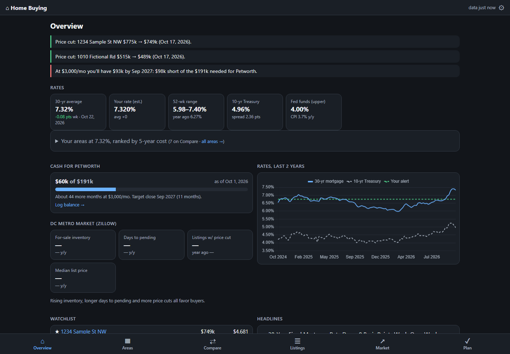
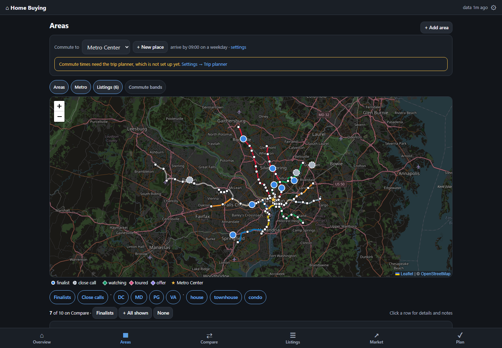
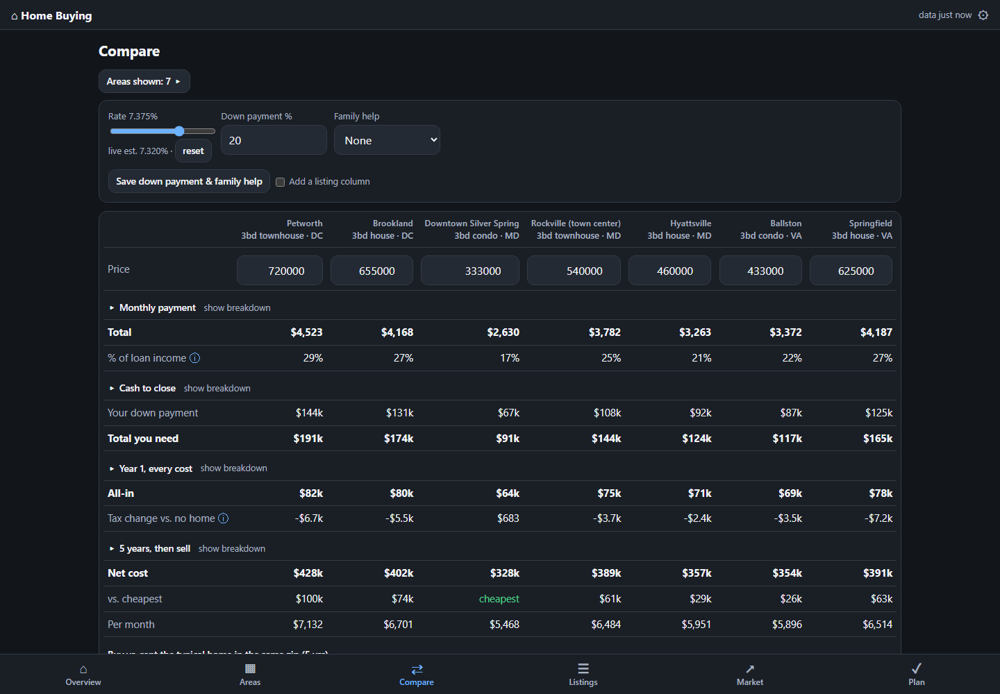

# Home Buying Dashboard

A self-hosted dashboard for planning a home purchase: live mortgage rates, the true monthly and 5-year cost of every neighborhood you're considering (with every tax worked out), commute times by transit and car, listings with price-cut tracking, local market data, and a savings plan.

It ships set up for the **Washington, DC area** (DC, Maryland and Virginia tax tables, the Metro map, regional transit for commutes) with **sample data**, so it works the moment you start it. Swap in your own numbers in Settings. If you live somewhere else, see [Using it in another city](#using-it-in-another-city).







## What's in it

- **Overview:** alerts (rate drops, price cuts, savings on or off track, deadlines), live rates, your areas ranked by 5-year cost, savings progress, metro market stats, your watchlist and headlines.
- **Areas:** every neighborhood you're considering in one sortable, filterable table (price range, monthly at low/typical/high, % of pay, year-1 all-in, 5-year cost, crime vs. county, commute by transit / park & ride / drive, effective property tax), with an interactive map (pins colored by any metric, Metro lines, listings, commute bands).
- **Commute places:** pick where you commute to. **+ New place** finds a landmark or address, or takes a dropped pin; the built-in trip planner computes every area's commute and the map's commute bands.
- **Compare:** every cost side by side (monthly, cash to close, every tax, year-1 all-in, 5-year buy-and-sell, buy vs. rent) with rate / down-payment / family-help what-ifs, a custom listing column, rate sensitivity, and gift vs. loan.
- **Listings:** add homes by hand or import Redfin's *Download All* CSV; re-imports record price changes. Each listing gets the full cost breakdown.
- **Market:** Zillow home values (all, 2-bed, house, condo), rents and forecasts for your zips; metro inventory, days to pending, price cuts; rates since 2014.
- **Plan:** log your house-fund balance, projection vs. cash needed, a steps checklist, key dates.
- **Settings:** incomes, loan assumptions, family help, areas, every tax table (state, county, federal), news feeds, data-feed status.

The cost engine handles federal and state income tax (including whether itemizing beats the standard deduction, the SALT cap and the mortgage-interest limit), county income tax, property tax with homestead deductions, Virginia car tax, transfer/recordation taxes, PMI, HOA, insurance, maintenance, appreciation and selling costs.

## Quick start

You need [Docker](https://www.docker.com/products/docker-desktop/).

```
git clone https://github.com/elijahwidener/home-buying-dashboard.git
cd home-buying-dashboard
docker compose up -d --build
```

Open http://localhost:3081. That's it.

| Task | Command |
|------|---------|
| Start | `docker compose up -d` |
| Stop | `docker compose down` |
| Update after pulling changes | `docker compose up -d --build` |
| Logs | `docker compose logs -f` |

**Without Docker** (Node 24 or newer; the commute planner also needs Java 25 and `osmium`, so it's easier in Docker):

```
npm install
npm run dev        # data goes to ./data
```

## Make it yours

The first launch fills in **sample data**: made-up incomes, ten sample neighborhoods, seven fake listings and a few months of savings. Replace it in this order:

1. **Settings → You:** names, salaries, pre-tax retirement %, filing status, savings, monthly savings, target closing month, cars.
2. **Settings → Loan & assumptions:** down payment, and your rate spread (your lender's quote minus the weekly Freddie Mac average).
3. **Areas:** click a row → *Edit details* to change a sample area, *Remove* to drop it, **+ Add area** for your own. Price ranges, crime and commute notes on the samples are made up.
4. **Areas → Commute to → + New place:** add your workplace.
5. **Settings → Backup & reset → Remove sample data:** deletes the sample listings and savings entries.
6. **Listings:** import a Redfin search (*Download All* at the bottom of the results) or add homes by hand.

To start with an empty database instead, copy `.env.example` to `.env` and set `DEMO_DATA=0` before the first start.

**Tax rates are not live.** They're the 2026 values in Settings → Tax tables. Check them each January.

## Live data (no API keys)

| Source | What | Refresh |
|--------|------|---------|
| FRED (Freddie Mac PMMS, Treasury, Fed, CPI) | 30/15-yr mortgage averages, 10-yr yield, Fed funds, inflation | every 3 h |
| Zillow Research CSVs | Zip values, 2-bed values, rents, 1-yr forecast; metro inventory, days to pending, price cuts, list price | checks every 12 h, downloads when Zillow publishes (monthly) |
| OpenStreetMap Nominatim | Place search when adding a commute place or area (only the typed text is sent) | when you search |
| US Census geocoder | Map points for hand-added listings (Redfin CSVs include them) | after adding, then every 6 h |
| Google News RSS | Housing, rates and local news (editable in Settings) | hourly |

Your rate = this week's 30-yr average + the spread you set in Settings.

### Commute times (trip planner)

Commute times come from [OpenTripPlanner](https://www.opentripplanner.org/) running inside the container, using real weekday transit schedules (Metrorail, Metrobus, Ride On, TheBus, MARC, MTA commuter bus, Fairfax Connector, ART, DASH, from the Mobility Database mirror) and OpenStreetMap streets for the region.

- **Set up once:** Settings → Trip planner data → *Build* (downloads ~1 GB, 10–30 min, ~5 GB memory while building; ~400 MB on disk after).
- **Runs only when needed:** it starts when something is missing (a new place, a moved or new area, changed settings), computes, and stops a minute later (~2 GB while running).
- **Driving** has no live traffic: car time × the rush-hour factor in Settings (default 1.5), plus 5 minutes to park.
- **Rebuild** every few months or after service changes.

Everything else works without the trip planner; commute columns just stay empty.

## Using it in another city

Everything regional is data, so you can point it anywhere in the US:

| What | Where |
|------|-------|
| Areas, incomes, loan, feeds, key dates | Settings (no code needed) |
| Jurisdictions (property tax, county income tax, transfer tax, car tax, zip prefixes) | Settings → Tax tables, or the defaults in `src/lib/config.ts` |
| State income tax tables | `states` in `src/lib/config.ts` (MD, DC and VA are included; add yours with the same shape) |
| Zillow metro market stats | `METRO` in `src/lib/server/sources/zillow.ts` (Zillow's metro name) |
| Trip planner region and transit agencies | `BBOX` and `FEEDS` (Mobility Database ids) in `src/lib/server/otp.ts` |
| Metro lines/stations on the map | `src/lib/metro.json`, rebuilt from `scripts/data/` by `node scripts/build-metro.mjs` |

Run `npm test` after changing tax tables: it prints every default area's costs so you can sanity-check them.

## Security

There is no login. Keep it on your home network or a private network like [Tailscale](https://tailscale.com/), never on the public internet.

- **Phone on home Wi-Fi:** `http://<your computer's IP>:3081`
- **Anywhere:** run Tailscale on the computer and phone, then use the computer's Tailscale name or IP.

## Data and backups

- The database is SQLite, in the Docker volume `homebuy_homedata`.
- **Settings → Download backup** saves a consistent copy while the app runs.

## Development

```
npm install
npm run dev        # http://localhost:5173, data goes to ./data
npm run check      # type-check
npm test           # cost-engine sanity check (optionally: npm test -- 6.5 for a rate)
```

Built with SvelteKit, Node's built-in `node:sqlite`, Leaflet and Chart.js.

## Not financial advice

This is a planning tool. Tax tables, crime figures and sample prices can be wrong or out of date. Check numbers with a lender, a tax professional and your county before you make decisions.

## Support

If this helped your search, you can buy me a coffee on Venmo: **[@elijahwidener](https://venmo.com/u/elijahwidener)**. Totally optional, and thanks!

## License

[MIT](LICENSE)
